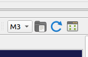
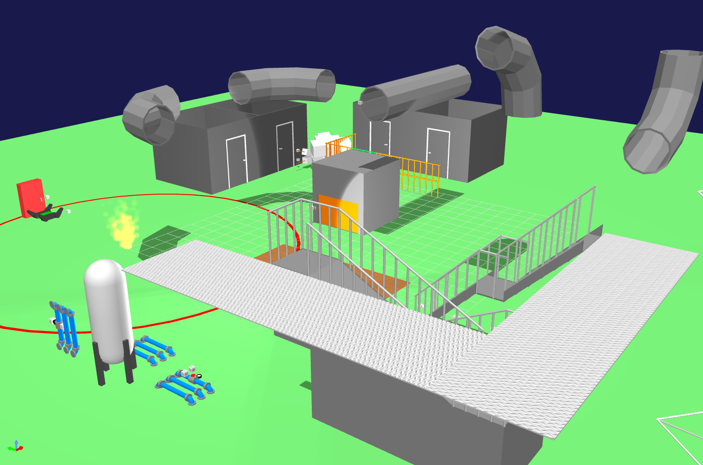
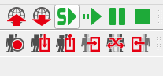

# NITRo-UI_WRS2025

This repository sets up the development environment for the WRS2025 simulation competition.
It installs ROS 2 Humble, AGX Dynamics, and Choreonoid (with the WRS2025 environment) on Ubuntu 22.04, and builds the workspace.

## Requirements

- Ubuntu 22.04 (amd64)
- ROS 2 Humble
- AGX Dynamics 2.40.0.0
- Choreonoid v2.4.0
- choreonoid_ros (master)

## Before you start

- Register an SSH key with GitHub (the URLs in the `.repos` file use SSH)
- Get the AGX Dynamics license file (`agx.lic`) from the competition secretariat

## Directory structure

```
NITRo-UI_WRS2025/
├── NITRo-UI.repos        # List of repositories fetched by vcs import
├── script/               # Setup and build scripts
└── wrs_ws/               # colcon workspace (created by 03)
    └── src/
        ├── choreonoid/
        │   └── ext/
        │       ├── WRS2024PRE/
        │       ├── WRS2025/
        │       └── hairo-world-plugin/
        ├── choreonoid_ros/
        ├── choreonoid_joy2/
        └── nitro-ui_simulation/
```

## Setup

### 1. Clone this repository

```bash
cd ~
git clone git@github.com:RRL-NITRo/NITRo-UI_WRS2025.git
cd NITRo-UI_WRS2025
```

### 2. Install ROS 2 Humble

```bash
bash script/01_ros_setup.sh
```

### 3. Install AGX Dynamics

```bash
bash script/02_agx_setup.sh
```

After installation, place the license file `agx.lic` in `/opt/Algoryx/AGX-2.40.0.0/`.

### 4. Set up Choreonoid and the WRS2025 environment

**Open a new terminal** before running this step.

```bash
bash script/03_choreonoid.sh
```

This fetches the repositories, installs the Choreonoid dependencies, and builds the workspace.
When it finishes, open a new terminal to apply the environment.

### 5. Place the NITRo-UI robot models in Choreonoid

Copy `choreonoid_model_NITRoUI` from `nitro-ui_simulation` into Choreonoid's `ext/`.

```bash
cp -r ~/NITRo-UI_WRS2025/wrs_ws/src/nitro-ui_simulation/choreonoid_model_NITRoUI ~/NITRo-UI_WRS2025/wrs_ws/src/choreonoid/ext/
```

Then build only Choreonoid.

```bash
cd ~/NITRo-UI_WRS2025/wrs_ws
colcon build --symlink-install --packages-select choreonoid
```

The build copies the models and project files to `install/`.
Whenever you change anything in `choreonoid_model_NITRoUI` (`.body`, `.cnoid`, `.yaml`), repeat this step (copy → build).

## Running the simulation

### 1. Start Choreonoid

Start Choreonoid with the registration file (`.yaml`) for the field you want to use.
For example, to use the practice field (M3):

```bash
ros2 run choreonoid_ros choreonoid ~/NITRo-UI_WRS2025/wrs_ws/src/choreonoid/ext/choreonoid_model_NITRoUI/project/registration_m3.yaml
```

### 2. Select a field

Select the field from the drop-down at the top right of the window (shown as `M3` in the image below).



### 3. Load the field

Of the icons to the right of the drop-down, click the third one (the green arrows). The field and the robots are loaded.



### 4. Start the simulation

Click the green "S" icon at the top left of the window to start the simulation.



### Registration files

The fields you can select depend on the `.yaml` you start Choreonoid with.
All files are in `choreonoid_model_NITRoUI/project/`.

| File | Description | Fields |
|---|---|---|
| `registration_m3.yaml` | WRS2025 practice field | `M3` |
| `registration_20251009.yaml` | WRS2025 competition day 1 | `PS-ALL` `PS-1` `PS-2` `PS-3` `PS-4` |
| `registration_20251010.yaml` | WRS2025 competition day 2 | `PS-ALL` `PS-1` `PS-2` `PS-3` `PS-4` |
| `registration_20251011.yaml` | WRS2025 competition day 3 (semifinal) | `PS-ALL` `PS-1` `PS-2` `PS-3` `PS-4` |
| `registration_20251012.yaml` | WRS2025 competition day 4 (final) | `PS-ALL` `PS-12` `PS-34` |
| `registration_wrs2024pre.yaml` | WRS2024 pre-competition | `M2-A1` `M2-A2` `M2-A3` `M2-A4` `M2-A12` `M2-A34` |

## Launching the operator screens

Run these in another terminal while the simulation is running.

UGV operator screen:

```bash
ros2 launch operator_launcher rviz.launch.py
```

UAV operator screen:

```bash
ros2 launch operator_launcher rviz_drone.launch.py
```

## Scripts

| Script | Description |
|---|---|
| `01_ros_setup.sh` | Installs ROS 2 Humble, colcon, and vcstool |
| `02_agx_setup.sh` | Downloads and installs AGX Dynamics |
| `03_choreonoid.sh` | Fetches repositories → installs dependencies → builds |
| `04_vcs_import.sh` | Fetches the repositories in `NITRo-UI.repos` (called by 03) |
| `10_ws_build.sh` | Builds the workspace |
| `11_ws_reset.sh` | Removes `build/` `install/` `log/` (asks before removing `src/`) |

## Rebuilding

```bash
bash script/10_ws_build.sh
```

If the build breaks, remove the build artifacts and rebuild.

```bash
bash script/11_ws_reset.sh
bash script/10_ws_build.sh
```

If you also removed `src/` with `11_ws_reset.sh`, fetch the repositories again with `04_vcs_import.sh` before rebuilding.
Note that removing `src/` also deletes any uncommitted changes.

## Notes

- `hairo-world-plugin` uses the RRL-NITRo fork (`fix-wrsutil` branch).
- Choreonoid is pinned to v2.4.0 in `NITRo-UI.repos`. Newer versions changed the `Device` API, and `hairo-world-plugin` fails to build with them.
- The following lines are added to `.bashrc` (they are not added twice).

  ```bash
  source /opt/ros/humble/setup.bash
  source /opt/Algoryx/AGX-2.40.0.0/setup_env.bash
  source ~/NITRo-UI_WRS2025/wrs_ws/install/setup.bash
  ```

## References

- [WRS-2025](https://github.com/wrs-frei-simulation/WRS-2025)
- [Choreonoid](https://choreonoid.org/)
